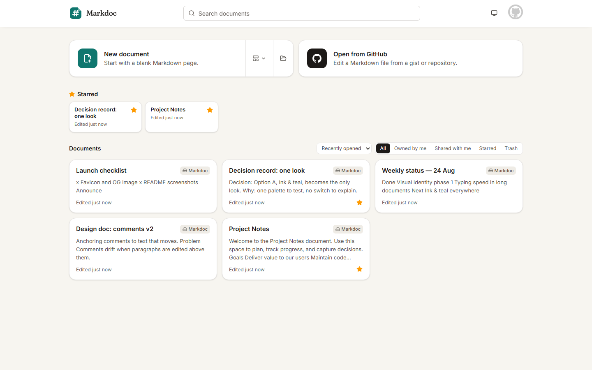
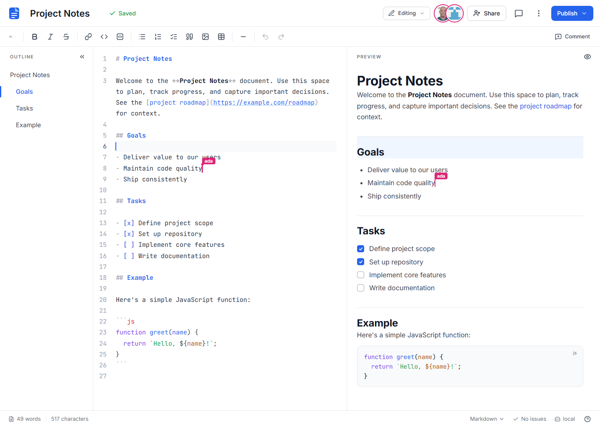
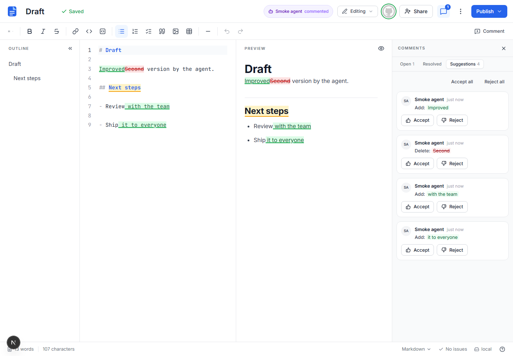

# Markdoc

Markdown, together. Write Markdown with other people in real time, edit the **source** or the **rendered page** (both are live for everyone), review with **comments** and **suggestions**, keep every **version**, and **publish** to a GitHub gist or repository.





*Reviewing an agent's proposal:* an agent connected through MCP proposed edits and left a comment; the human accepts or rejects them in the app.



## What it does

What changed recently is in [CHANGELOG.md](CHANGELOG.md).

### Writing

- Two-pane live editor: CodeMirror source and a ProseMirror rich pane side by side; type in either, the other follows instantly.
- Markdown-aware typing in the code pane: a third `` ` `` opens a fenced block, backticks never auto-pair, `*` `_` `` ` `` `[` wrap the selection, Tab / Shift-Tab nest and outdent list items.
- GitHub Flavored Markdown (tables, task lists, footnotes, front matter, raw HTML kept) with a linter in the status bar and jump-to-line.
- Slash menu: type `/` in the rich pane for headings, lists, tables, code blocks with a language, images, links, comments, today's date.
- Command palette (`Ctrl+Shift+P`, or `Ctrl+K` with nothing selected) for every editor and dashboard command.
- Find & replace across both panes (`Ctrl+F` / `Ctrl+H`), with live highlights.
- Smart paste: a URL over a selection becomes a link, Markdown-looking text is inserted as source, HTML keeps bold/lists, and tab-separated plain text (a spreadsheet range, `psql` or `jq -r @tsv` output) becomes a table in either pane.
- Tables with a floating menu and shortcuts for rows, columns and alignment.
- Images by paste, drop or upload, stored as assets behind `/api/assets`.
- Document statistics and a shared writing goal (`Ctrl+Shift+C`): words, sentences, reading time, selection counts.
- Templates: meeting notes, design doc, weekly status, blog post, decision record, checklist and more.
- Dark mode: system / light / dark, applied before paint so there is no flash; toggle in the status bar, dashboard header, `/settings` and the command palette. Exports keep the light print stylesheet.
- Accessible by keyboard and screen reader: skip link and landmarks, a one-tab-stop toolbar with arrow keys, dialogs and the palette return focus to what opened them, AA contrast in both themes; every screen is scanned with axe in the e2e suite.

### Collaborating

- Real-time editing over Yjs and WebSockets with presence avatars and live carets in both panes; hover an avatar to see which section a collaborator is in, click to jump there or follow their cursor (`Esc` stops).
- Comments anchored to text that follow the words as they move; reply, edit, resolve, reopen; `@mentions` with a suggestions popover.
- Suggesting mode: edits become tracked changes (green/red) that anyone with edit access can accept or reject, one by one or all at once.
- Version history with automatic snapshots, named versions, word-level diffs and one-click restore.
- Version compare: diff any two versions, swap sides, step through hunks, see moved paragraphs as moves, rename a version or copy it as a new document.
- Activity panel per document: who edited, commented, suggested, published or shared, with agents marked.
- Notifications: a bell in the editor header and a strip on the dashboard when someone replies to your thread, resolves it, accepts or rejects your suggestion, shares with you or @mentions you; `?thread=` links open the thread.
- Share by GitHub handle as editor, commenter or viewer, or by link (restricted, view, comment, edit).
- Reader view at `/p/<id>`: clean read-only page with a table of contents, reading time and download menu.
- Offline editing that survives a refresh or a closed tab; edits merge on reconnect and the header shows what is unsaved.

### Organising

- Dashboard search looks inside document content and shows a snippet around each match.
- Stars, recently opened, and sort order that is remembered.
- Templates gallery on the dashboard and in the empty state.
- Trash with restore for 30 days, then permanent deletion.
- Make a copy of any document you can view.

### Exporting

- Markdown, standalone HTML (images embedded) or a Letter PDF from the header menu or `GET /api/documents/:id/export`.
- Publish to a GitHub gist or a repository file (a real commit on the branch you choose); import from either.
- Safe sync with GitHub: the Publish button shows whether the document is in sync, ahead, behind or diverged; publish and pull refuse to overwrite the other side, and the Sync dialog merges three-way (conflicts left as markers the linter flags), keeps yours or takes GitHub's.

### Agents

- Personal API tokens, a REST API, and an MCP server (`mcp/server.mjs`) so GitHub Copilot, Claude or scripts can create documents, propose tracked changes and answer comments; the app shows who did what. See [docs/agents.md](docs/agents.md).
- Copilot CLI as a collaborator: Markdoc serves MCP itself at `/api/mcp` (Streamable HTTP) — paste the config from the Share dialog's *Collaborate with an agent* card and the agent sits in the document with a bot avatar, a status and its own caret (`markdoc_presence`), waits for comments, edits, mentions and requests with `markdoc_watch`, and can be called by name as `@you/Copilot-CLI` from the `@` picker in any comment. See [What an agent session looks like](docs/agents.md#what-an-agent-session-looks-like).
- Fewer permission prompts: every tool carries MCP annotations (read-only, additive, destructive), so Copilot CLI never asks before a read, and the Share and Connect cards carry a `copilot --allow-tool …` line that pre-allows the safe writes for a session. See [Permissions in Copilot CLI](docs/agents.md#permissions-in-copilot-cli).
- **Ask an agent** from the document: select text (or nothing), pick an instruction and how the agent should answer (tracked changes, comment only, rewrite). The request waits in an inbox agents read over MCP (`markdoc_list_requests` → `markdoc_claim_request` → work with `requestId` → `markdoc_complete_request`); a header pill tracks it live, and the result comes back as suggestions plus a notification. Nothing runs server-side — your own Copilot CLI does the work. First-time users get a *Connect an agent* card with the MCP config for the host they are on. See [Requests](docs/agents.md#requests).

Sign in is GitHub only (OAuth), with a development login for local work.

### Keyboard shortcuts

`Ctrl` is `Cmd` on macOS. Press `Ctrl+/` in the editor for the full list.

| Shortcut | Action |
| --- | --- |
| `Ctrl+Shift+P` | Command palette |
| `Ctrl+K` | Command palette (no selection) / Link (with a selection) |
| `Ctrl+F` / `Ctrl+H` | Find / Find and replace |
| `Ctrl+Shift+C` | Document statistics and writing goal |
| `Ctrl+Alt+M` | Add a comment on the selection |
| `Ctrl+B` / `Ctrl+I` / `Ctrl+Shift+X` | Bold / Italic / Strikethrough |
| `` Ctrl+` `` | Inline code |
| `Ctrl+Alt+1…6` / `Ctrl+Alt+0` | Heading 1–6 / Paragraph |
| `Ctrl+Shift+8` / `Ctrl+Shift+7` / `Ctrl+Shift+9` | Bulleted / Numbered / Task list |
| `Ctrl+Alt+C` | Code block |
| `Ctrl+Alt+↓` / `Ctrl+Alt+→` | Table: row below / column right (`↑` / `←` for above / left) |
| `Ctrl+/` | Keyboard shortcuts help |

## Run it locally

Requirements: Node.js 22+ and npm. No database or Docker needed: an embedded Postgres (PGlite) is used when `DATABASE_URL` is not set.

```bash
npm install
cp .env.example .env.local   # then edit: set AUTH_SECRET (any long random string)
npm run dev                  # http://<machine-name>:3000 (stable LAN URL)
```

With `AUTH_DEV_LOGIN=1` (the default in `.env.example`) the login page offers a **development login** that accepts any handle, so you can open two browsers as two users without a GitHub OAuth app. Set `GITHUB_TOKEN` (for example from `gh auth token`) to use gists and repositories with the development login.

The server listens on all interfaces (`HOST` overrides). Use `http://<machine-name>:3000` as the canonical local URL from this computer, a phone, or another LAN client; it survives DHCP address changes. The start-up log prints that stable name first, then its `<machine-name>.local` alias, loopback, and deterministically ordered numeric interface addresses as secondary diagnostics (virtual/WSL adapters are labelled and never select the canonical URL). Sign-in, the collaboration-token request, and the one active `/collab` socket follow the browser's origin. In development, Next's cross-origin guard for `/_next/*` includes both stable names and current numeric diagnostics (`scripts/lib/dev-origins.mjs`; `ALLOWED_DEV_ORIGINS=a,b` adds others). A DHCP change needs no restart for hostname access; restart only if you are deliberately troubleshooting through the new numeric IP. `e2e/lan.spec.ts` covers the stable-hostname path.

Changing from a numeric URL (for example `http://192.168.1.20:3000`) to the hostname is a one-time origin transition. Cookies, `localStorage`, and IndexedDB are scoped to the exact origin, so sign in once at the hostname. Markdoc cannot invisibly move an unsynced IndexedDB edit from the old numeric origin: reconnect and save it at the old URL before switching, or copy the text manually if that address is no longer reachable.

To sign in with GitHub for real, create an OAuth App (Settings → Developer settings → OAuth Apps) with the callback URL on the same stable origin, for example `http://<machine-name>:3000/api/auth/callback/github`, and set `AUTH_GITHUB_ID` / `AUTH_GITHUB_SECRET`. Markdoc requests the `read:user user:email gist repo` scopes so it can publish on your behalf. With the OAuth app set, an account that has no GitHub token (the development login) gets a **Sign in with GitHub** button in the GitHub dialogs; without it, *Open from GitHub* and the *Connect to GitHub…* / *Gist or repository…* entries are disabled and say that GitHub storage is not set up on this server.

### Environment variables

| Variable | Required | Purpose |
| --- | --- | --- |
| `AUTH_SECRET` | yes | Signs sessions and collaboration tokens. |
| `AUTH_GITHUB_ID`, `AUTH_GITHUB_SECRET` | for GitHub login | GitHub OAuth App credentials. |
| `AUTH_URL` | in production | Public URL, e.g. `https://markdoc.example.com`. |
| `DATABASE_URL` | in production | Postgres connection string. Omit locally to use PGlite in `.data/pglite`. |
| `DATABASE_SSL` | optional | Set to `1` to require TLS (Azure PostgreSQL). |
| `AUTH_DEV_LOGIN` | dev only | `1` enables the development login (ignored when `NODE_ENV=production`); `force` enables it in production too, only for smoke-testing a local build. |
| `GITHUB_TOKEN` | dev only | Personal token used for gists/repos with the development login. |
| `PGLITE_DATA_DIR` | optional | Embedded database location; `memory://` for tests. |
| `AUTO_VERSION_INTERVAL_MS` | optional | How often automatic versions are captured while editing (default 10 minutes). |
| `CHROMIUM_PATH` | optional | Chromium executable for PDF export; Playwright's own download is used when unset. |
| `DRIZZLE_MIGRATIONS_DIR` | optional | Where startup migrations are read from (default `./drizzle`). |
| `APP_VERSION` | optional | Reported by `/api/health` (the Dockerfile sets it from the `APP_VERSION` build arg). |

## Test it

```bash
npm test              # Vitest: ~430 unit tests (parser/serializer, sync binding, comments/suggestions models, DB, routes, collaboration server); the incremental-parser fuzz runs 300 seeded docs
npm run test:e2e      # Playwright: ~220 tests in 41 specs (two-browser collaboration, comments, suggestions, versions, sharing, tables, templates, search, stars, trash, reader, palette, notifications, offline, dark mode, phone layouts, import, …); e2e/scale.spec.ts runs the same flows against the Burke-scale fixture with measured budgets (CI: two shards for the suite, `--project default --shard=N/2`, plus a third job for the scale spec alone, `--project scale`)
npm run typecheck
npm run lint
```

- Burke-scale fixture: `e2e/fixtures/burke-scale.ts` seeds a ~12k-word document with 25 comment threads, 60 documents (starred, shared, trashed) and an API token; `e2e/scale.spec.ts` runs the long-document flows against it with measured budgets (`npx playwright test --project scale`; its own CI job), and `npm run seed:burke-scale` loads the same fixture into a dev server so you can try the app with real volume.

### Working in a worktree

A second checkout (`git worktree add ../markdoc-task-x -b task-x`) needs its own `npm ci --ignore-scripts`: Turbopack refuses to run from a junctioned or symlinked `node_modules`, so linking the main checkout's dependencies is not enough. No `.env.local` is needed — `PORT=3800 npm run dev:port` starts with dev-only auth defaults (see below) and a private PGlite directory, and `E2E_PORT=3218 npm run test:e2e` gives the suite its own port and Next cache.

### Scripts and knobs

Every `npm run` script, and the environment variables the test tooling reads:

| Script / variable | What it does |
| --- | --- |
| `dev` | Dev server (Next + collaboration WebSocket) on `:3000`. |
| `dev:port` | `PORT=3800 npm run dev:port`: a dev server on its own port with `.next-manual-<port>` and `.data/pglite-<port>`, so it never collides with the suite or another dev. Without `.env.local` it fills in dev-only defaults (`AUTH_SECRET=dev-only-secret-<port>`, `AUTH_DEV_LOGIN=1`, `RATE_LIMIT=off`) and prints which ones it applied; anything you set wins (`RATE_LIMIT=on` to try the API limiter by hand). |
| `build` / `build:server` | `next build` plus the custom server bundled to `dist/server.mjs` (`build:server` does only the second step). |
| `start` | Production server from `dist/`. |
| `start:local` | Production server on `:3900` with a throwaway PGlite and the dev login forced on, for local smoke tests. |
| `smoke` | API smoke against `BASE_URL` (default `:3900`): health, dev login, dashboard, template doc, PNG asset round-trip, md/html/pdf export. `SMOKE_PDF_OPTIONAL=1` tolerates a 503 from PDF. |
| `seed:burke-scale` | Loads the Burke-scale fixture (`e2e/fixtures/burke-scale.ts`: a ~12k-word document with 25 comment threads, 60 documents, 10 starred, 8 in the trash, 12 shared, an API token) into a dev server through the public API so you can look at the app with real volume. `MARKDOC_URL` (default `:3870`), `SEED_OWNER` / `SEED_PEER` dev-login handles; refuses port 3000 without `--yes`. Takes ~15 s on a `dev:port` server (limiter off by default); on a server with the API rate limiter on it honours every `429`'s `Retry-After` instead (~4 min), or start that server with `RATE_LIMIT=off`. |
| `test` / `test:watch` | Vitest once / in watch mode. |
| `test:fuzz` | Full 1500-document incremental-parser fuzz (`FUZZ_DOCS` / `FUZZ_SEED` override; the seed is logged on failure). |
| `test:e2e` | Playwright; starts its own server on `:3100` with an in-memory database. `posttest:e2e` removes the run's Next cache afterwards. |
| `tsconfig:revert` | Undo the `include` churn `next dev` writes into `tsconfig.json` when that is the only change. |
| `typecheck` / `lint` | `next typegen && tsc --noEmit` / `eslint` (Markdown files are not linted). |
| `db:generate` | `drizzle-kit generate`: a new migration under `drizzle/` after a schema change. |
| `mcp` | Run the MCP server from a checkout (`MARKDOC_URL`, `MARKDOC_TOKEN`). |
| `mcp:smoke` | Checks a running server's `/api/mcp` with a real MCP client (`MARKDOC_URL`, `MARKDOC_TOKEN`): the `GET` card, the `401` without a token, `tools/list` against the stdio list with annotations, whoami, create and read. |
| `repair:github-identity` | Audits or repairs one legacy development identity and its empty GitHub OAuth duplicate. It is dry-run by default; see the reviewed procedure below. |
| `MARKDOC_URL` / `MARKDOC_INTERNAL_URL` | Canonical public origin used in MCP links / trusted internal origin for the remote MCP route's REST callbacks. The custom server sets the internal origin to its own listener; other deployments default to `http://127.0.0.1:$PORT`. Set `MARKDOC_URL` behind a reverse proxy and set `MARKDOC_INTERNAL_URL` only when loopback cannot reach Markdoc. Both values must be bare http(s) origins: move any former URL-prefix routing to the proxy because paths, credentials, queries, and fragments now fail closed. Request forwarding headers never choose the callback destination. |
| `repair:imported-ystate` | Re-seeds `ystate` for documents imported before `8e1f8c9` whose stored text disagrees with it (`-- --dry-run` reports, `-- --id <docId>` targets one); run with the live server stopped. |
| `E2E_PORT` | Private port and Next cache (`.next-e2e-<port>`) for one e2e run; give each worktree its own on a shared machine. |
| `E2E_SERVER_LOG` | `1` pipes the e2e dev server's stdout into the Playwright output so hydration warnings can be grepped. |
| `PROD_BASE_URL` | Makes `e2e/prod-smoke.spec.ts` run against a built server instead of starting the dev server; the rest of the suite is skipped. |
| `READER_POLL_MS` | How often the reader view (`/p/:id`) polls for a newer version (default 30 s). |

`npm run test:e2e` deletes its Next cache (`.next-e2e`, or `.next-e2e-<port>`) before and after every run; `e2e/global-setup.ts` probes `/api/health` and warms the editor and API routes first so a cold compile never fails the first test. `next dev` appends the dist dir in use to `include` in `tsconfig.json`; `test:e2e` and `dev:port` revert that on exit when it is the only change, otherwise they print the diff (`npm run tsconfig:revert` does the same by hand). `next build` and `next typegen` type-check `tsconfig.build.json` instead — it extends the base, excludes `e2e/**`, `playwright.config.ts`, `scripts/**/*.mts` and `*.test.ts(x)` (the container image context has none of them) and, because it `extends`, Next never rewrites it; `npm run typecheck` (`tsc` on `tsconfig.json`) still covers the test code. `scripts/github-smoke.mts` exercises gist and repository publishing against the real GitHub API (needs a running server with `GITHUB_TOKEN` and a scratch repository; see the file header); `scripts/agent-smoke.mts`, `scripts/mcp-smoke.mts`, `scripts/perf-*.mts` and `scripts/screenshot.mts` are one-off dev tools with usage in their headers.

### One-time GitHub identity repair

`repair:github-identity` repairs only the case where a safe legacy development user and an otherwise empty OAuth duplicate have the same normalized GitHub login. It preserves the legacy user ID, moves exactly one GitHub account, and refuses unknown user references, ambiguous logins or email conflicts, extra accounts or sessions, and any application row tied to the duplicate user ID. Login-keyed collaborator and notification rows stay attached to the same normalized login and are fingerprinted without being rewritten. The command never merges application data.

Have the affected user sign out, take a database backup, and stop Markdoc so the repaired identity cannot write during the procedure. Markdoc sessions are JWT-backed, so this database command cannot revoke an existing browser cookie that still names the duplicate user ID; the repaired user must start with a fresh GitHub sign-in after the service restarts. Supply identifiers through the environment rather than credential-bearing command arguments:

```bash
export DATABASE_URL='postgresql://.../?sslmode=require'
export MARKDOC_REPAIR_LEGACY_LOGIN='expected-login'
export MARKDOC_REPAIR_GITHUB_ACCOUNT_ID='expected-numeric-id'
export MARKDOC_REPAIR_MANIFEST='/secure/operator-path/github-identity-rollback.json'

npm run repair:github-identity                 # dry-run; always rolls back
npm run repair:github-identity -- --apply      # one transaction; stages the rollback manifest before commit
npm run repair:github-identity -- --verify     # no-write verification against the manifest
```

Review the dry-run counts before `--apply`. Output contains only counts, booleans, classification labels, and hash prefixes. The checksummed rollback manifest contains the two user profile rows needed to reconstruct the deleted duplicate, but no OAuth tokens; store it as sensitive identity metadata and do not commit it.

Rollback is deliberately narrow: while Markdoc is still stopped and only if `--verify` passed, run `npm run repair:github-identity -- --rollback` with the same environment. It restores the original two profile rows and moves the same account back. Any changed profile, account, authentication row, or classified application fingerprint since apply makes rollback fail without writes. Once the repaired identity has signed in or created new data, restore from the database backup instead.

### Run the production build locally

The production server is `next build` plus the custom server bundled to `dist/server.mjs` (esbuild, see `scripts/build-server.mjs`). Exercise it before a deploy:

```bash
npm run build
npm run start:local                                 # production server on :3900, throwaway PGlite in .data/pglite-prod-smoke, dev login forced on
BASE_URL=http://localhost:3900 npm run smoke        # API smoke: health, dev login, dashboard, template doc, PNG asset round-trip, md/html/pdf export
PROD_BASE_URL=http://localhost:3900 npx playwright test e2e/prod-smoke.spec.ts   # browser: dashboard, template doc, typing in both panes over the WebSocket
```

`start:local` sets `AUTH_DEV_LOGIN=force`, which is the only way the development login works under `NODE_ENV=production`; never set it on a real deployment. `npm run smoke` exits non-zero on the first failing check (`SMOKE_PDF_OPTIONAL=1` tolerates a 503 from PDF export on hosts without Chromium). `e2e/prod-smoke.spec.ts` is skipped when `PROD_BASE_URL` is unset, so the regular suite is unaffected. Stop the server and delete `.data/pglite-prod-smoke` when you are done.

Next bundles server dependencies; `serverExternalPackages` in `next.config.ts` leaves only `@electric-sql/pglite` (WASM files), `pg`, `@hocuspocus/server`, `ws` and `yjs` (one instance shared with the custom server) to Node's loader. `drizzle-orm` is bundled on purpose: externalised, `@auth/drizzle-adapter`'s imports of `drizzle-orm/mysql-core` and `drizzle-orm/sqlite-core` became runtime `import()`s in every route chunk and intermittently failed in dev (`Failed to generate static paths` / `Failed to load external module`); `src/server/db/externals.test.ts` guards the list.

**PDF export needs Chromium.** `GET /api/documents/:id/export?format=pdf` renders with `playwright-core`; it answers `503` when no browser can be launched. Locally, `npx playwright install chromium` installs Playwright's build; on a server, point `CHROMIUM_PATH` at a system Chromium (the Dockerfile installs Alpine's and sets it).

### Accessibility

`npx playwright test e2e/a11y.spec.ts` runs axe-core (`@axe-core/playwright`, WCAG 2.1 A/AA tag set) against every screen and floating surface: login, dashboard (starred strip, trash chip, template dialog), the editor with outline and comments open and with each floating UI open in turn (find bar, slash menu, table menu, selection bubble, command palette, stats/presence/notifications popovers, share/image/shortcuts dialogs), the versions panel in compare mode, the activity panel, the reader page, settings, an iPhone 13 viewport, and dark mode for the dashboard and editor. Each state must report zero violations; on failure the rule id, impact and offending selectors are printed. `color-contrast` is disabled in the general light-theme scans (axe cannot resolve it through the blurred headers and translucent overlays) and enabled for the dark dashboard and dark editor scans (outline + comments, find bar, slash menu, table menu) and for the "axe: contrast" block, which scans the dashboard, editor, settings and reader in light and dark with it on; all pass with zero violations. The palette itself ("Ink & teal": warm stone inks, teal accent, Fraunces for titles and h1–h3, Inter for everything else) is checked as numbers in `src/app/tokens-contrast.test.ts` and `src/app/theme-contrast.test.ts`. The second half of the spec is a keyboard-only walkthrough (`page.keyboard` only): skip link → header → toolbar (one tab stop; `←`/`→` wrap, `Home`/`End` jump, disabled buttons are skipped, `Shift+Tab` back in lands on the last-used button) → panes, bold via `Ctrl+B`, command palette, commenting with `Ctrl+Alt+M`, Share via the palette with an exact check that `Esc` returns focus to the rich pane, Share from the header button returning focus to that button, and a check that the main controls resolve to unique accessible names. Set `A11Y_SOFT=1` to report every state in one run instead of stopping at the first failure. Note for keyboard users: the Markdown pane binds `Tab` to indent; press `Esc` then `Tab` to leave it.

## How it works

```text
 browser                                               server (one Node process)
 ┌─────────────────────────────────────────┐          ┌──────────────────────────────────────┐
 │ CodeMirror ◀── y-codemirror ──▶ Y.Text   │◀── WS ──▶│ Hocuspocus (auth, persistence,       │
 │ ProseMirror ◀─ MarkdownBinding ─▶  │     │          │   activity watcher, live API edits)  │
 │ comments / suggestions ◀──▶ Y.Map        │◀─ HTTP ─▶│ Next.js app + REST API + reader view │
 │ IndexedDB mirror (y-indexeddb)           │          │ Postgres via Drizzle (PGlite locally) │
 └─────────────────────────────────────────┘          └──────────────────────────────────────┘
```

- **The Markdown text is the document.** A Yjs `Y.Text` holds the source; CodeMirror binds to it directly. That keeps gists and repositories honest and conflict-free merging simple.
- **The rich pane is a lossless projection.** `src/editor/sync/markdown-binding.ts` serializes local ProseMirror edits block by block and applies them to the text as minimal diffs; text changes from anywhere (other users, the code pane, undo, an API call, a pull from GitHub) are parsed and applied to ProseMirror as a minimal replacement, so the caret and selection survive. Empty paragraphs, which Markdown cannot express, are kept locally as "phantom" blocks.
- **Carets are shared across surfaces.** Both editors publish the selection as a source-text position, so your caret in the code pane shows up in everyone's rich pane and vice versa.
- **Comments and suggestions are annotations** stored in Yjs maps with relative-position anchors (`src/editor/collab/`). They survive concurrent edits and render identically in both panes. Suggesting mode intercepts edits: deletions are kept and marked, insertions are recorded; accepting or rejecting applies the final text.
- **Open documents are mirrored to IndexedDB** (`src/editor/collab/offline.ts`, one `markdoc:<docId>` database per document via `y-indexeddb`), so edits made offline survive a refresh or closed tab and merge into the server copy on reconnect; the header shows the unsaved count while offline and confirms "All changes saved" once they land. The local copy is deleted when the document is deleted or access is revoked.
- **One server process.** `server/index.ts` hosts Next.js and the collaboration WebSocket (`/collab`) on one port. `src/server/collab/hocuspocus.ts` authenticates with short-lived JWTs minted by `/api/documents/:id/collab-token`, loads documents from Postgres and persists them (debounced) with automatic versioning. API edits go through the same live document (`src/server/livedoc.ts`), so an agent's `suggest` shows up in open editors immediately.
- **Activity is watched, not logged by the client.** `src/server/activity.ts` records rows from API routes and from a watcher on the live Hocuspocus document (typing is coalesced into one row per actor per ten minutes); the Activity panel reads `GET /api/documents/:id/activity`. Notifications (`src/server/notifications.ts`) are produced the same way, from the comment, suggestion and share routes and from the live document: replies, resolves, suggestion decisions, shares and @mentions, never for the actor; `GET /api/notifications` feeds the bell and the dashboard strip.
- **Assets live in Postgres.** Pasted or uploaded images are stored as `asset` rows (bytes, SHA-256, MIME) and served from `/api/assets/:id` with the owning document's access check; identical bytes within a document share one row, and "make a copy" copies the referenced ones.
- **Export and the reader view share one renderer.** `src/server/export/html.ts` turns clean Markdown into the standalone HTML page; `/p/:id` (`src/components/reader`) reuses `renderMarkdownBody` and the `contentHash` to show a "new version" pill, and PDF export prints the same HTML through Chromium. The Markdown → HTML pipeline itself lives in `render-markdown.ts` and runs on a worker thread (`render-pool.ts`, one lazy worker, 15 s budget, `dist/render-worker.mjs` in production) behind a linear guard (`src/editor/markdown/renderable.ts`) that refuses paragraphs with more than 1 000 `]` or 2 000 `*`/`_` — micromark resolves those quadratically and 80 KB of unbalanced brackets used to block the whole process for 38 s; refused documents answer `422 { error: "Document is not renderable" }`.
- **Per-user tables for organising.** `star` and `recent` rows drive the dashboard's stars, recently-opened order and sort; trash is a `deleted_at` column on `document` that hides it from every route until it is restored or purged after 30 days.
- **Build.** `drizzle-orm` is bundled into the server (not externalised; see the note under *Run the production build locally*), and `src/server/db/externals.test.ts` pins the short list of packages Node loads from `node_modules`.

## Deploy to Azure

The target is **Azure Container Apps** with a private PostgreSQL VM. The VM has no public IP after bootstrap and accepts TLS database connections only from the Container Apps subnet. Infrastructure is in `infra/main.bicep`; `deploy/azure.ps1` provisions everything and builds the image in Azure Container Registry (no local Docker). Nothing deploys automatically; `.github/workflows/deploy.yml` is a manual workflow. The image (`Dockerfile`) is `node:22-alpine` with Alpine's Chromium for PDF export and a `HEALTHCHECK` on `/api/health`; validate changes to it with `npm run build` + the production smoke above and `hadolint Dockerfile` (no local Docker needed).

```powershell
$env:MARKDOC_PG_PASSWORD = '<strong password>'
$env:MARKDOC_AUTH_SECRET = '<openssl rand -base64 32>'
$env:MARKDOC_GITHUB_CLIENT_ID = '<oauth app id>'
$env:MARKDOC_GITHUB_CLIENT_SECRET = '<oauth app secret>'
$env:MARKDOC_ALERT_EMAIL = '<production alert receiver>'
$env:MARKDOC_VM_SSH_PUBLIC_KEY = Get-Content "$HOME\.ssh\id_ed25519.pub" -Raw
.\deploy\azure.ps1 -InitializeDatabase -ConfigureRecovery
# The first run prints the app URL; add it as the OAuth callback, then rerun normally.
```

For unattended production deployment, pass `-SecretsPath <file>` instead. The CLIXML file must contain `PostgresAdminPassword`, `AuthSecret`, `GitHubClientId`, `GitHubClientSecret`, `AlertEmailAddress`, and `VmAdminSshPublicKey` as DPAPI-encrypted `SecureString` properties. Secure Bicep values are written to a randomly named parameter file only for the duration of each Azure CLI call and removed in `finally`; they are never command-line arguments.

Ordinary reruns deliberately do not attach a VM public IP, write the PostgreSQL password to Key Vault, rerun database bootstrap, restart PostgreSQL, or change database ownership. A new environment requires the explicit `-InitializeDatabase` flag. Password rotation requires `-RotateDatabasePassword`; it stages the candidate separately, verifies the current credential, applies and verifies the candidate, and restores the active credential if candidate verification fails before the app or active Key Vault secret changes. `-SimulateDatabaseRotationFailure` proves that pre-change failure path without modifying PostgreSQL. Recovery configuration changes require `-ConfigureRecovery`. `-SourceCommit <full-sha>` labels the image with an accepted application commit only when every application file in the clean deployment checkout matches that commit. `-ImageTag <full-sha>` reuses an existing ACR image. Run `-VerifyRecovery` to restore the latest physical backup into an isolated scratch cluster without stopping or modifying production.

The PostgreSQL recovery layers are:

- pgBackRest continuously archives WAL to a private Azure Blob container using the VM's managed identity. `archive_timeout=240s` bounds the recovery point to five minutes after a write, including quiet periods.
- A full physical pgBackRest backup and a separate `pg_dump` logical backup run daily. pgBackRest retains seven full backups; logical dumps expire after 30 days.
- Azure Recovery Services also keeps seven daily encrypted VM recovery points. This is an additional disaster-recovery layer, not the point-in-time database backup.
- A two-minute systemd check validates repository access, physical-backup freshness, the age of any pending WAL archive backlog, pgBackRest spool status, and unresolved archive failures. The five-minute backlog-age bound is tied to `archive_timeout=240s`; an idle database with no unarchived WAL does not false-alert. Its secret-free health object includes archive age and backlog measurements. Its heartbeat and failures flow through a restricted NAT egress path to Log Analytics, and both Azure Monitor rules notify the production action group.
- A weekly job restores the latest physical backup to an isolated local socket and temporary data directory, starts it on port 55432, verifies the `markdoc` database after recovery, records the duration off-VM, then removes the scratch cluster. Run `-VerifyRecovery` after recovery changes and confirm it finishes within the two-hour RTO.

Approximate monthly cost shape (East US 2, pay-as-you-go; storage, backup, and logs vary with database size and traffic, so verify current prices in the Azure Pricing Calculator):

| Resource | Size | ~$/month |
| --- | --- | --- |
| Container App | 0.5 vCPU / 1 GiB, one always-on replica | 34 |
| Container App (`-Small`) | 0.25 vCPU / 0.5 GiB | 14 |
| Container App (`-ScaleToZero`) | sleeps when nobody is connected | ~0 idle |
| PostgreSQL VM + OS disk | Standard B1ms, 32 GiB Standard SSD LRS | usage-priced |
| PostgreSQL controlled egress | Standard NAT Gateway + one Standard public IP; no public IP on the VM | usage/data-priced |
| PostgreSQL recovery storage | Standard StorageV2 LRS, hot tier; WAL + 7 physical + 30 logical daily backups | capacity/operations |
| Recovery Services backup | Standard vault, daily VM recovery point, seven-day LRS retention | protected-instance/storage |
| Container Registry | Basic | 5 |
| Log Analytics / Azure Monitor | 30-day logs, 1 GiB/day workspace cap, two backup alerts | ingestion/alerts |

The collaboration server keeps open documents in memory, so the app runs as a single replica; scaling out would need Hocuspocus's Redis extension.

## Project layout

```text
server/index.ts              custom server: Next.js + collaboration WebSocket on one port
src/app                      pages: dashboard, /login, /d/[id] editor, /p/[id] reader, /settings
src/app/api                  REST routes (documents, content, suggest, comments, versions, activity,
                             assets, export, share, star, trash, templates, notifications, tokens, GitHub)
src/components/editor        editor UI: header, toolbar, panes, panels (comments, versions, activity),
                             command palette, slash menu, find bar, table menu, stats popover, dialogs
src/components/dashboard     document list, search, stars/recents/sort, templates gallery, notifications strip
src/components/notifications notifications bell in the editor header, open-thread helper
src/components/reader        /p/[id] reader view: page, table of contents, update pill, download menu
src/components/settings      API tokens
src/editor/markdown          GFM schema, parser with source map, incremental parser, serializer, linter
src/editor/sync              ProseMirror <-> Y.Text binding, text diff
src/editor/collab            session, comments, suggestions, offline (IndexedDB) models
src/editor/codemirror        source pane setup, commands, suggesting filter
src/editor/prosemirror       rich pane setup, commands, input rules, tables, node views
src/server/db                Drizzle schema, connection (Postgres or PGlite), externals guard
src/server/collab            Hocuspocus server, JWT collab tokens, document registry, WebSocket
src/server/export            Markdown -> standalone HTML renderer (shared with the reader), PDF via Chromium
src/server/github            Octokit: gists, repositories, import
src/server/documents.ts      create/list/search/star/recent/trash/duplicate
src/server/livedoc.ts        apply API edits to the live Yjs document (content, suggest, comments)
src/server/activity.ts       activity rows from routes and the live-document watcher
src/server/notifications.ts  notification rows (replies, resolves, suggestion decisions, shares, @mentions) + live watcher
src/server/assets.ts         image assets in Postgres
src/server/publish.ts        link/publish/pull against gists and repositories
src/server/tokens.ts         personal API tokens
mcp/server.mjs               MCP server over stdio (see docs/agents.md)
drizzle/                     migrations, applied at startup:
  0000_init                    users, sessions, documents, collaborators, versions, stars
  0001_api_tokens              personal API tokens
  0002_timestamptz             all timestamps to timestamptz
  0003_assets                  image assets (bytes + sha256 per document)
  0004_mentions                @mentions per comment and mentioned login (replaced by 0008)
  0005_activity                per-document activity feed
  0006_recent                  per-user recently-opened documents
  0007_trash                   document.deleted_at for the trash
  0008_notifications           notification table; migrates and drops mention
e2e/                         Playwright specs; global-setup.ts health-probes and warms routes,
                             dist-dir.ts gives each E2E_PORT its own Next cache
scripts/smoke.mts            API smoke against a running (production) server
scripts/dev-port.mts         dev server on a private port/cache/db
scripts/build-server.mjs     esbuild bundles: server/index.ts -> dist/server.mjs, the Markdown render worker -> dist/render-worker.mjs
scripts/live/                PowerShell ops for Burke's live :3000 server (start, promote, autostart, snapshot/restore, resume-check)
infra, deploy                Bicep and deployment script
```

## Live test server (Burke's :3000)

Burke's live test server runs `npm run dev` from a pinned sibling worktree `../markdoc-live` (env in that folder's `.env.local`), with PGlite data and the log under the sibling `../markdoc-data`. Both default paths are derived from the repo location; set `FACTORY_ROOT` (or pass `-Root` / `-LogPath`) to point elsewhere — see `Get-FactoryRoot` in `scripts/live/common.ps1` and its Node twin `scripts/lib/factory-root.mjs`. Ops scripts live in `scripts/live/` (Windows PowerShell 5.1 compatible):

- `start-live.ps1` — idempotent start: exits 0 if `/api/health` already answers 200, otherwise kills stale `markdoc-live` node processes, deletes `.next`, starts `npm run dev` hidden (log appended to `../markdoc-data/live.log`, rotated at 20 MB) and waits for `ok:true, db:true`. While waiting, "connection refused" and any 5xx count as *still starting* (a cold Next.js server compiles the route on the first hit and may answer 500 meanwhile); it waits at least `-MinWaitSec` (90) and at most `-TimeoutSec` (180), gives up early only when the launcher process exits, and prints a `NOT HEALTHY: <reason>` line on failure.
- `promote.ps1 -Sha <sha>` — what the lead does at every merge: verifies the sha is on `origin/main`, stops the server, `git checkout --detach <sha>`, runs `npm ci --ignore-scripts` only if `package.json`/`package-lock.json` changed, clears `.next`, restarts; rolls back to the previous sha only when the process exited or health was not `ok:true, db:true` after the wait above, and prints `ROLLBACK REASON: …`. Rehearse against a copy with `-Root <worktree> -Port <n> -LogPath <file>`, never against :3000.
- `install-autostart.ps1` — registers two per-user scheduled tasks (no admin): "Markdoc live server" (at logon, runs `start-live.ps1`) and "Markdoc snapshot" (every 15 min, runs `snapshot-data.ps1 -Latest`); `-Uninstall` removes both. Re-run it from `markdoc-live` after the first promote that includes these scripts so the tasks point at the permanent path.
- `snapshot-data.ps1 [-Latest | -Out <dir>]` / `restore-data.ps1 [-From <dir>]` — hot backup of the PGlite database through `GET /api/admin/backup` (gated by `BACKUP_TOKEN`) as `markdoc-pglite.tar.gz` + `manifest.json`, and the matching restore via PGlite's `loadDataDir`. `-Latest` (the default) rewrites `../markdoc-data/snapshots/latest` atomically and keeps the last 3 timestamped copies; `-From` defaults to that folder.
- `resume-check.ps1` (`npm run resume-check`) — checklist that exits 0 when the live server is fully back after a machine wipe, repairing what it safely can (`-DryRun` to only report).

**Wipe-proofing.** [RESUME.md](RESUME.md) is the recovery document: what state Markdoc keeps on the machine and where (live worktree, `.env.local`, the PGlite data folder, the scheduled tasks), what the snapshot contains and how it is taken without stopping the server, where the 15-minute snapshot lands in factory-state, how to restore it, which secrets have to be re-entered and how to regenerate them, and the `resume-check.ps1` checklist the factory's bootstrap script runs after cloning everything back from GitHub.

## License

MIT
